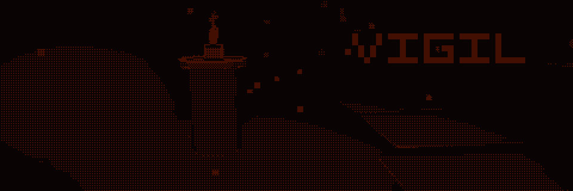
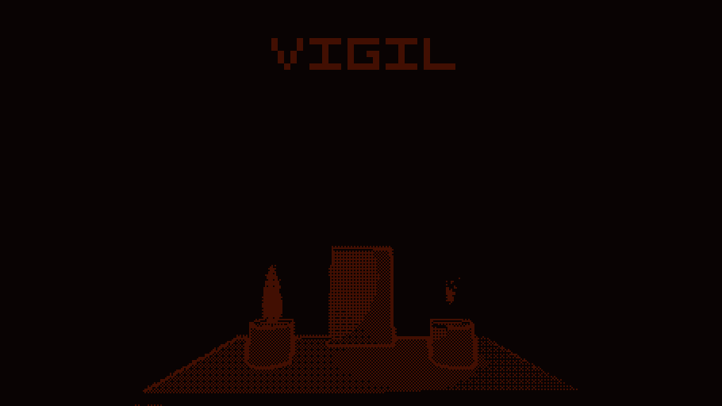
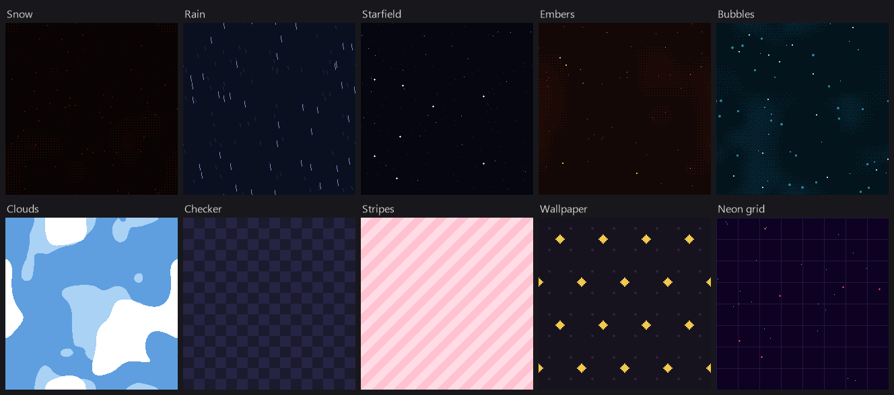
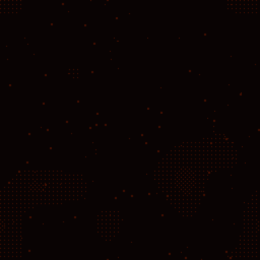

# GIF Kit

Record seamless looping GIFs and stills in play mode and generate tiling backgrounds for itch.io and other store pages

Everything runs in the editor and nothing ends up in builds

*VIGIL's itch.io banner: real snow particles looped, candle flicker blended, title as an overlay (960 x 320, 96 frames, 222 KB)*

## Install

1. Open **Window -> Package Manager**
2. Click **+** and choose **Install package from git URL...** (**Add package from git URL...** in older Unity versions)
3. Paste `https://github.com/maukii/GifKit.git`

To use a local copy instead, choose **Install package from disk...** and pick `package.json`

Open the tool from **Window -> GIF Kit**

## Capture

Enter play mode, set up the moment you want and press **Record GIF** or **Take still**

Files are saved to `Captures/` in the project folder (outside `Assets`) unless you pick another folder

- **Source** - **Camera** renders one camera off screen at the exact size you ask for, **Game View** grabs the Game view as it is with UI included
- **Camera pose** - **Free** leaves the camera alone, **Hold** freezes it where it is (no head bob or drift), **Scene View** uses the Scene view's angle so you can frame the shot there
- **Size** - presets for itch.io banners, covers and screenshots, or any size you type in
- **Pixel scale** - renders at 1/N size and scales up with hard pixels, pick the scale that matches your game's pixel resolution
- **Frames and FPS** - the loop length, game time moves exactly one frame per capture so recordings stay smooth even when the editor is slow
- **Loop particles** - makes every playing particle system loop perfectly
- **Blend frames** - dissolves the last frames into the first with an ordered dither, hiding the jump in anything that doesn't loop on its own like light flicker, shader noise or animation
- **Palette** - **Auto** keeps every colour exact when there are 255 or fewer and reduces to 255 otherwise, **Fixed** maps everything to the colours you list
- **Overlay** - a texture stamped on every frame such as a logo or title, pixels under 50% alpha are skipped

After each recording the window reports the loop seam: how many pixels differ between the last and first frame, next to how many change on an ordinary frame

If the seam is well below an ordinary frame, the loop is invisible

*VIGIL's main menu: Hold pose, pixel scale 2, title overlay, ember particles looped (910 x 512, 48 frames, 44 KB)*

### How particle looping works

GIF Kit pauses every playing particle system, simulates it ahead in fixed steps and snapshots every particle

Each recorded frame shows only the particles born inside one loop window, with their ages wrapped around the loop, so whatever a system emits the last frame flows straight into the first

Particles that live longer than the loop work too, the snow in the banner lives 12 seconds inside a 9.6 second loop

## Tile

Builds seamless, looping backgrounds from a stack of layers, for itch.io pages or your own menus

Every layer wraps at the tile edges and every movement completes whole cycles per loop, so whatever you stack tiles in space and loops in time

*The ten presets: Snow, Rain, Starfield, Embers, Bubbles, Clouds, Checker, Stripes, Wallpaper and Neon grid*

Start from a preset or an empty stack, then add layers

- **Noise** - clouds, fog, water or lava from tileable noise, drawn with hard edges or a 2x2, 4x4 or 8x8 Bayer dither
- **Particles** - snow, rain streaks, rising embers or bubbles, twinkling stars, drifting leaves, as squares, dots, pluses, streaks or your own sprites
- **Pattern** - checker, stripes, diagonal stripes, dots, grid or bricks
- **Sprites** - your own sprites repeated on a staggered grid, the classic itch.io wallpaper (a diamond stands in until you add one)

Each layer picks a colour from the palette, how many whole tiles it moves per loop and its own seed, so shuffling one layer never changes the others

The palette can have any number of colours, typed in or taken from a texture

The preview plays the loop and repeats the tile so you can check the seams, and a warning appears if a pattern or sprite spacing doesn't divide the tile size

Save a PNG, a GIF, or a repeating point-filtered texture asset for use inside the game

*The Snow preset, which is VIGIL's page background pixel for pixel (512 x 512, 128 frames, 282 KB)*

## GIF details

- Global palette with LZW compression, loops forever
- Frames after the first only store the pixels that changed and leave the rest transparent, which keeps long pixel-art loops small
- Browsers clamp frame delays under 20 ms, so anything above 50 FPS plays slower than recorded
